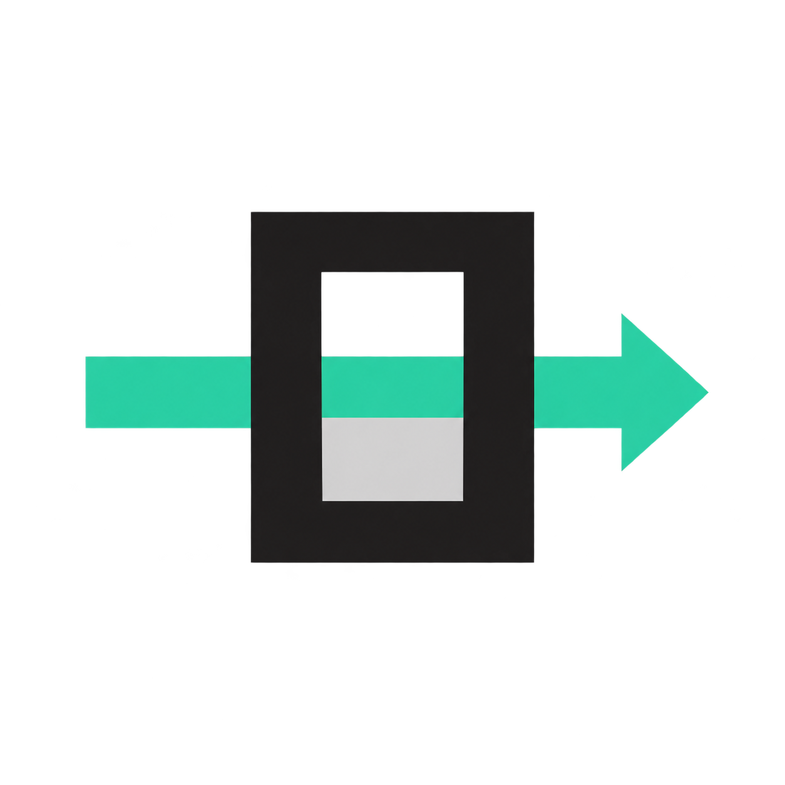

<p align="center">
  
</p>

<h1 align="center">OpenCode API</h1>

<p align="center">
  Access OpenCode's API from any OpenAI-compatible client.<br>
  <strong>Local · Lightweight · No npm dependencies</strong>
</p>

<p align="center">
  <a href="#startup">Startup</a> ·
  <a href="#dockerpodman">Docker/Podman</a> ·
  <a href="#commands">Commands</a> ·
  <a href="#models">Models</a> ·
  <a href="#updates">Updates</a>
</p>

---

Use OpenCode's API without keeping OpenCode running. The relay exposes an **OpenAI Chat Completions** compatible API at `http://127.0.0.1:4097/v1`, with text, reasoning, tool calls, and streaming.

The relay runs on Node. The full OpenCode engine is used only to extract the required protocol, then removed along with its temporary dependencies. The Harness executes the tools.

> **Model enabled in this relay:** `deepseek-v4.1-flash-free`. The list below describes the OpenCode catalog; other models are not enabled here. No paid fallback.

## Startup

```sh
git clone https://github.com/PwnPeter/opencode-local-api.git
cd opencode-local-api
```

### System

**Installs: local API + DeepSeek Harness**

```sh
./setup
```

### Docker/Podman

**Docker · API only**

```sh
docker compose build
docker compose run --rm relay python3 scripts/install.py prepare
docker compose up -d --wait --wait-timeout 600
docker compose exec relay cat /data/opencode-local-api/harness.env
```

**Podman · API only**

```sh
podman compose build
podman compose run --rm relay python3 scripts/install.py prepare
podman compose up -d
podman compose exec relay cat /data/opencode-local-api/harness.env
```

## Requirements

- git; Python 3.10+ for the guided launcher
- Container option: Docker Compose v2, or Podman with a [Compose provider](https://docs.podman.io/en/latest/markdown/podman-compose.1.html) such as `podman-compose`; no host Node or systemd required
- Native option: Linux with user systemd services, Node.js 24+ (or 22.19+ on 22.x), npm, curl, make; the guide installs missing packages with apt or dnf
- [OpenCode API key](https://opencode.ai/console/): **Account → Personal API keys → Add API key → Create**; paste it at the hidden prompt. [Details](https://opencode.ai/v2/docs/console/api/#personal-api-keys).
- x86_64 or ARM64 (tested on Fedora and Kali x86_64)

## Commands

| Command | Action |
| --- | --- |
| `./setup` | Guides installation; rerun after an interruption to resume |
| `make harness` | Opens the Harness with the local API and `deepseek-v4.1-flash-free` configured |
| `make status` | Shows service status |
| `make logs` | Follows service logs |
| `make start` / `make stop` | Starts or stops the relay |
| `make restart` | Restarts the relay |
| `make refresh` | Downloads OpenCode, extracts, tests, and cleans up |
| `make verify` | Tests the installed protocol against the free model |
| `make test` | Runs local tests without a key or provider requests |
| `docker compose logs -f relay` / `podman compose logs -f relay` | Follows container logs |
| `docker compose down` / `podman compose down` | Stops the container; keeps credentials and protocol |

## Layout

```text
src/       Relay runtime
scripts/   Setup, extraction, verification
config/    Harness profile and service template
tests/     Node and Python tests
assets/    Logo
setup      Guided launcher
```

## Models

**Checked on October 21, 2026.** Pricing comes from the [official documentation](https://opencode.ai/v2/docs/console/models/#pricing); catalog entries come from the [official models API](https://opencode.ai/inference/v1/models). Being listed by this API does not guarantee access for every account.

### Free

Sorted by published [Artificial Analysis Intelligence Index](https://artificialanalysis.ai/models/releases), highest first. Scores describe the underlying models at AA's tested reasoning settings, not measurements of OpenCode's free endpoints. All IDs below are listed by the OpenCode API; access and uptime depend on the account and provider.

| Model | ID | AA index |
| --- | --- | ---: |
| **DeepSeek V4.1 Flash 1017** | **`deepseek-v4.1-flash-free`** | **45** |
| MiniMax M3.1 Flash Free | `minimax-m3.1-flash-free` | 43 |
| GLM-5.3-Flash Free | `glm-5.3-flash-free` | 42 |
| MiMo-V2.6-Flash Free | `mimo-v2.6-flash-free` | 38 |
| Beam Free | `beam-free` | 30 |
| Nemotron 3.5 Super VL Free | `nemotron-3.5-super-vl-free` | 26 |
| Nemotron 3.5 Lightning Free | `nemotron-3.5-lightning-free` | 13 |
| Big Pickle | `big-pickle` | Not rated |
| LongCat 2.5 Preview Free | `longcat-2.5-preview-free` | Not rated |
| Jev 1.13 Free | `jev-1.13-free` | Not comparable |

Unrated models are not ranked below the others on capability. Jev uses a structured decision API rather than interchangeable chat.

### Unlisted

| Model | Documented ID |
| --- | --- |
| LL Alpha Free | `ll-alpha-free` |
| Exo Free | `exo-free` |
| MiMo-V2.5 Free | `mimo-v2.5-free` |
| Nemotron 3 Ultra Free | `nemotron-3-ultra-free` |

### Unlimited

The [Go / Go Plus documentation](https://opencode.ai/v2/docs/console/go/#usage-limits) explicitly lists **LongCat 2.5 Preview Free**, **Beam Free**, and **MiniMax M3.1 Flash Free** as **Unlimited** during their promotional period.

This applies to the paid Go / Go Plus subscriptions; it does not guarantee unlimited access with a Console key without a subscription. Beam also has geographic restrictions, detailed in the documentation.

Other free models are not described here as unlimited: free access is temporary and guarantees neither throughput nor availability. DeepSeek Free works with the key used to test this relay; unlimited access has not been established for that account.

## Updates

### Native

```sh
make refresh
```

### Docker

```sh
docker compose build --pull
docker compose run --rm relay python3 scripts/install.py prepare --refresh
docker compose up -d --wait --wait-timeout 600 --force-recreate
```

### Podman

```sh
podman compose build --pull
podman compose run --rm relay python3 scripts/install.py prepare --refresh
podman compose up -d --force-recreate
```

The script downloads the latest official release, extracts only the required protocol, tests a response and a streaming tool round trip, then removes the binary and its temporary dependencies. There is no need to keep the OpenCode sources.

**If the checks fail, the working protocol and current service are preserved.** An incompatible upstream change may require adapting the relay.

`make install` reuses an existing protocol; a fresh installation uses the reference version **1.19.3**. Initial extraction, `make refresh`, and `make verify` send requests to the free model.

## Configuration

The setup guide saves your credentials before extraction. Rerunning `./setup` reuses them, keeps the verified protocol, and skips the Harness download when it is already installed. An interrupted extraction restarts safely; completed steps are kept.

Docker/Podman runs the API with Node inside the container. For a client installed separately:

| Setting | Value |
| --- | --- |
| Base URL | `http://127.0.0.1:4097/v1` |
| API key | `OPENCODE_LOCAL_API_KEY` printed by the container command in Startup |
| Model | `deepseek-v4.1-flash-free` |

The upstream OpenCode key stays in the container volume. Repeat the Docker or Podman startup commands after an interruption; saved credentials and protocol are reused. `compose down` keeps this data. Use `RELAY_PORT=4098` with each Compose command to select another host port. `./setup` also offers the Docker mode.

<details>
<summary>Automation</summary>

Set `OPENCODE_API_KEY` in the environment when running `make install`. The local token is generated separately.

</details>

- Repository code and tests require no external dependencies to install.
- `~/.config/opencode-local-api/environment`: your upstream key and a separate local token; the directory follows `XDG_CONFIG_HOME` when set.
- `harness.env`: only the local token to load into the Harness.
- `envelope.json`: extracted protocol without an API key.
- Docker/Podman: the same private files are stored in the `relay-data` volume, outside the repository.
- `~/.config/systemd/user/opencode-local-api.service`: runs only Node.

The service starts at each user login. Run `make install` again after moving the project.

Configuration is private (`0700` for the directory, `0600` for files). None of these local files are published. Each user supplies their own key. The native service and published container port listen only on `127.0.0.1`. Both require the local token; the relay does not log messages or keys. Requests pass through OpenCode and its model provider.

## Conversations

The relay preserves your agent's messages and tools. It no longer prepends the full OpenCode system prompt and keeps only two native compatibility tool definitions (`bash` and `read`). On a small test request, overhead drops from roughly 7,800 to 2,000 tokens, about 75% less; savings depend on the tools already supplied by the client.

The `x-opencode-session`, `x-opencode-session-id`, and `x-dsh-session-id` headers are recognized. Each client identity maps to a stable native identifier, renewed after 30 minutes. Without a header, the relay hashes the first user message to keep the same route during Harness tool calls. Two conversations with exactly the same first message may share this routing identity; each request retains its own complete history.

The cache stores only hashes and identifiers, with a maximum of 512 entries, without saving text or keys. Invalid types for messages, tools, or the `stream` parameter are rejected with a `400` error before any provider request.

## Limitations

The Harness profile reserves some context space. The relay executes no tools: the Harness runs its own and may reject a native tool it does not recognize. Extraction and live probes in `make refresh` check that the reduced protocol is still accepted before installing it.

The relay reproduces the extracted request format and native identifiers; it does not generate cryptographic signatures. The free model and compatibility may change on OpenCode's side. Initial extraction temporarily requires several hundred MB of disk space, and the native engine consumes memory during that step.

<details>
<summary>Uninstall</summary>

```sh
systemctl --user disable --now opencode-local-api.service
```

Remove the provider configuration from your Harness before deleting the project. Keys and any private backups are not deleted automatically.

</details>

---

[MIT License](LICENSE) · [Official OpenCode](https://github.com/anomalyco/opencode) · [Reference version](https://github.com/anomalyco/opencode/tree/v1.19.3)

The identifier codec comes from `packages/schema/src/identifier.ts`, under the MIT license. The logo was created with `imagegen`, based on the [OpenCode mark](https://opencode.ai/brand): a mint proxy arrow crossing the gateway, on a transparent background.
